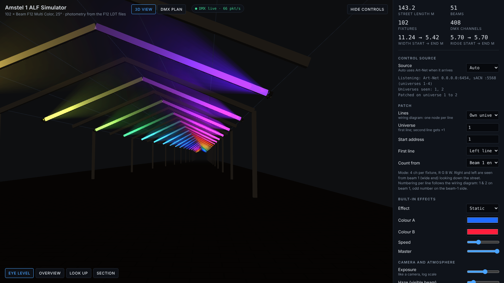
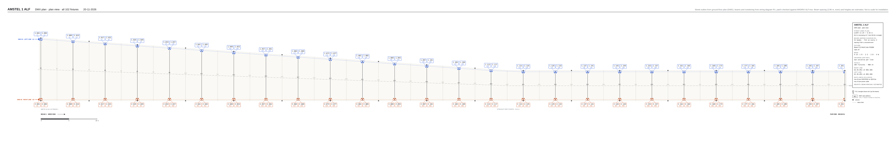
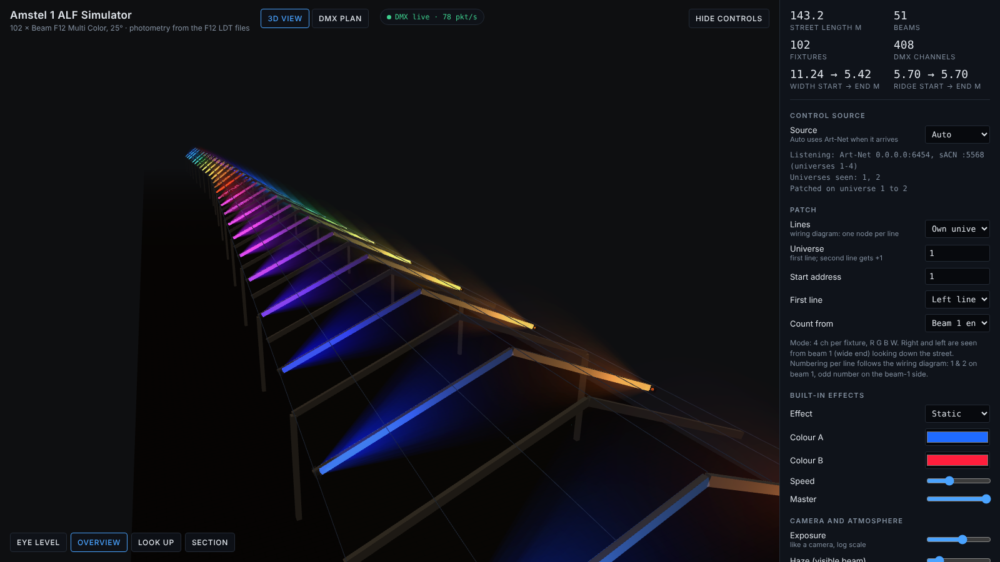
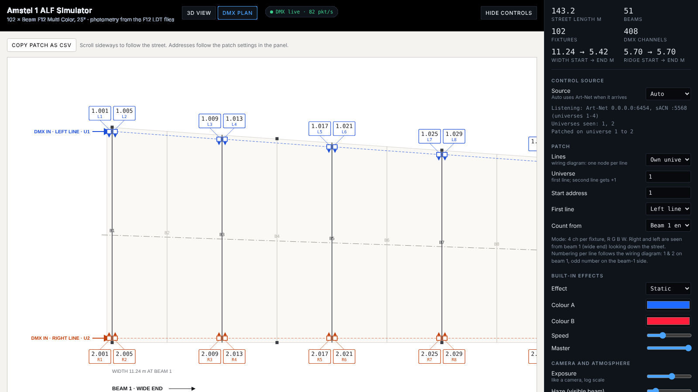

# Amstel 1 ALF Simulator

A live 3D preview and DMX plan of the ALF light installation in the glass street at Amstel 1: 102 Beam F12 Multi Color (RGBW, 25°) grazing the roof beams. Send Art-Net from MADRIX or any other Art-Net software on your own computer and see the result in the browser.

A collaboration between ALF, OneEightyOne (181) and Amstel 1.



## Contents

1. [What is in this repo](#what-is-in-this-repo)
2. [How it works](#how-it-works)
3. [Quick start](#quick-start)
4. [Sending Art-Net from MADRIX](#sending-art-net-from-madrix)
5. [Patch](#patch)
6. [Screenshots](#screenshots)
7. [Bridge options](#bridge-options)
8. [Troubleshooting](#troubleshooting)
9. [Data sources and limits](#data-sources-and-limits)

## What is in this repo

| Path | What it does |
|---|---|
| `amstel1_alf_bridge.py` | Receives Art-Net, serves the simulator and passes the DMX to it. Python standard library only. |
| `artnet_test_sender.py` | Test patterns (chase, walk, full, off), to check the setup without MADRIX. |
| `web/index.html` | The simulator: 3D view, DMX plan and patch table. |
| `web/lib/` | three.js r128 (MIT licence), so the page also works offline. |
| `docs/screenshots/` | The images in this README. |

## How it works

```
MADRIX (or other Art-Net software)
        |
        |  Art-Net, UDP port 6454
        v
amstel1_alf_bridge.py  ----  http://localhost:8080  ---->  browser (web/index.html)
```

A web page cannot receive Art-Net by itself. The bridge listens for Art-Net on UDP 6454, serves the page at http://localhost:8080 and pushes every universe to it over a WebSocket. It also answers ArtPoll, so consoles that discover nodes see it as `Amstel1 ALF Sim`.

> [!NOTE]
> Opening `web/index.html` directly, or through GitHub Pages, only shows the built-in effects. Live Art-Net works only at http://localhost:8080 with the bridge running.

## Quick start

You need Python 3.8 or newer. No packages to install.

**1. Get the files**

```
git clone https://github.com/albert-181/Amtel1-simulator.git
cd Amtel1-simulator
```

**2. Start the bridge and open the simulator**

```
python amstel1_alf_bridge.py --open
```

On Windows you can also use `py amstel1_alf_bridge.py --open`. You should see:

```
Amstel 1 ALF Simulator bridge
  listening: Art-Net 0.0.0.0:6454; sACN :5568 (universes 1-4)
  simulator: http://localhost:8080
  Ctrl+C to stop
```

`--open` opens http://localhost:8080 in your browser. Without it, open that address yourself.

**3. Test it without MADRIX**

In a second terminal:

```
python artnet_test_sender.py chase
```

Within a second the pill at the top of the page turns green and shows `DMX live`. Both lines show a moving rainbow. The bridge prints the packets it receives every 5 seconds:

```
  rx last 5 s: Art-Net 394, sACN 0 packets, universes [1, 2], pages 1
```

Other patterns:

| Command | What you see |
|---|---|
| `python artnet_test_sender.py walk` | One fixture per line lights up at a time, in address order. Use it to check the patch. |
| `python artnet_test_sender.py full --rgbw 0 0 255 0` | All fixtures in one colour (R G B W values 0 to 255). |
| `python artnet_test_sender.py off` | Blackout. |

Stop the sender with Ctrl+C. It sends a blackout when it stops.

## Sending Art-Net from MADRIX

1. **Patch:** use the patch below, universes 1 and 2, 4 channels per fixture.
2. **Output:** send both universes as Art-Net to `127.0.0.1` when MADRIX runs on the same computer as the bridge, or to the IP address of the computer that runs the bridge. Broadcast on the local network also works.
3. **Check:** in the panel on the right of the page, under Control source, `Universes seen` must show `1, 2`. With Source on `Auto` the page switches from the built-in effects to your DMX as soon as packets arrive.

> [!IMPORTANT]
> The bridge passes the Art-Net universe on exactly as it is sent (port-address, 0 = first). If `Universes seen` shows `0, 1` instead of `1, 2`, your software counts from 0 on the wire. Set **Universe** in the Patch section of the page to `0`. The second line follows automatically.

## Patch

Mode: 4 channels per fixture, `1 R · 2 G · 3 B · 4 W`. Each line has its own Art-Net node and universe. Numbering follows wiring diagram R1 and starts at beam 1, at the wide end of the street.

| Line | Universe | Fixtures | Start addresses |
|---|---|---|---|
| Left | 1 | L1 to L51 | 1, 5, 9 ... 201 |
| Right | 2 | R1 to R51 | 1, 5, 9 ... 201 |

Fixture `n` on a line starts at address `1 + 4 × (n − 1)`.

Fixtures hang in pairs, one each side of a beam, on every second beam: 1 & 2 on beam 1, 3 & 4 on beam 3, up to 49 & 50 on beam 49, and 51 alone on beam 51. The odd number is on the beam-1 side. Left and right are seen from beam 1, looking down the street.

This patch is checked against the MADRIX patch `ALF.msz` (MADRIX 5.8): all 102 fixtures match on universe, start channel and order along the street. MADRIX row Y=1 is the left line (universe 1), row Y=23 the right line (universe 2).

In the page, the **DMX plan** tab shows every fixture with its address, and **Copy patch as CSV** copies the full patch table.



## Screenshots

**Overview from the wide end, Art-Net chase from the test sender**



**DMX plan tab: addresses per fixture, data input per line**



## Bridge options

```
python amstel1_alf_bridge.py [options]
```

| Option | Default | Use |
|---|---|---|
| `--open` | off | Open the simulator in the default browser. |
| `--artnet-ip IP` | `0.0.0.0` (all) | Listen for Art-Net on one network interface only, for example `127.0.0.1`. |
| `--artnet-port N` | 6454 | Art-Net port. |
| `--http-port N` | 8080 | Web port of the simulator. |
| `--http-host IP` | `127.0.0.1` | Use `0.0.0.0` to open the simulator from other devices on the network. |
| `--fps N` | 60 | Maximum updates per second to the page. |
| `--no-sacn` | off | Do not listen for sACN. |

The test sender takes `--ip`, `--left`, `--right` and `--start` to test other destinations, universes and start addresses:

```
python artnet_test_sender.py walk --ip 192.168.1.50 --left 0 --right 1
```

## Troubleshooting

| What you see | What to do |
|---|---|
| `Art-Net port 6454 is busy or not allowed` | Another program already uses port 6454, often the Art-Net software itself. Try `--artnet-ip 127.0.0.1`, send to a second network adapter, or run the bridge on another computer and send Art-Net to its IP. |
| Pill shows `Bridge offline` | The bridge is not running, or the page was not opened at http://localhost:8080. |
| Pill shows `Bridge ready · no DMX` | No Art-Net arrives. Check the destination IP, that output is enabled, and that the firewall allows Python on UDP 6454. |
| Wrong fixtures light up | Compare `Universes seen` with the patch and set Universe in the Patch section. Run `artnet_test_sender.py walk` to follow the address order. |
| Left and right swapped | Set **First line** to Right in the Patch section. |

## Data sources and limits

| Item | Source |
|---|---|
| Street outline: 11.24 m wide at beam 1, narrowing at 4.0° over 83.2 m, then 59.94 m straight at 5.42 m | Ground floor plan `100 plattegrond begane grond` (DWG) |
| 51 beams, F12 on every second beam, numbering and lines | Wiring diagram `OneEightyOne_ALF_Wiring Diagram_R1` |
| Universes and addresses | MADRIX patch `ALF.msz` |
| Light output and beam shape | Beam F12 Multi Color LDT files |
| Beam spacing 2.86 m, assumed even over 143.15 m | Estimate |
| Column height 3.5 m, ridge height 5.7 m | Estimate |

The structure is fixed in the page. Positions and light levels are a preview for programming, not a lighting calculation or an installation drawing.
